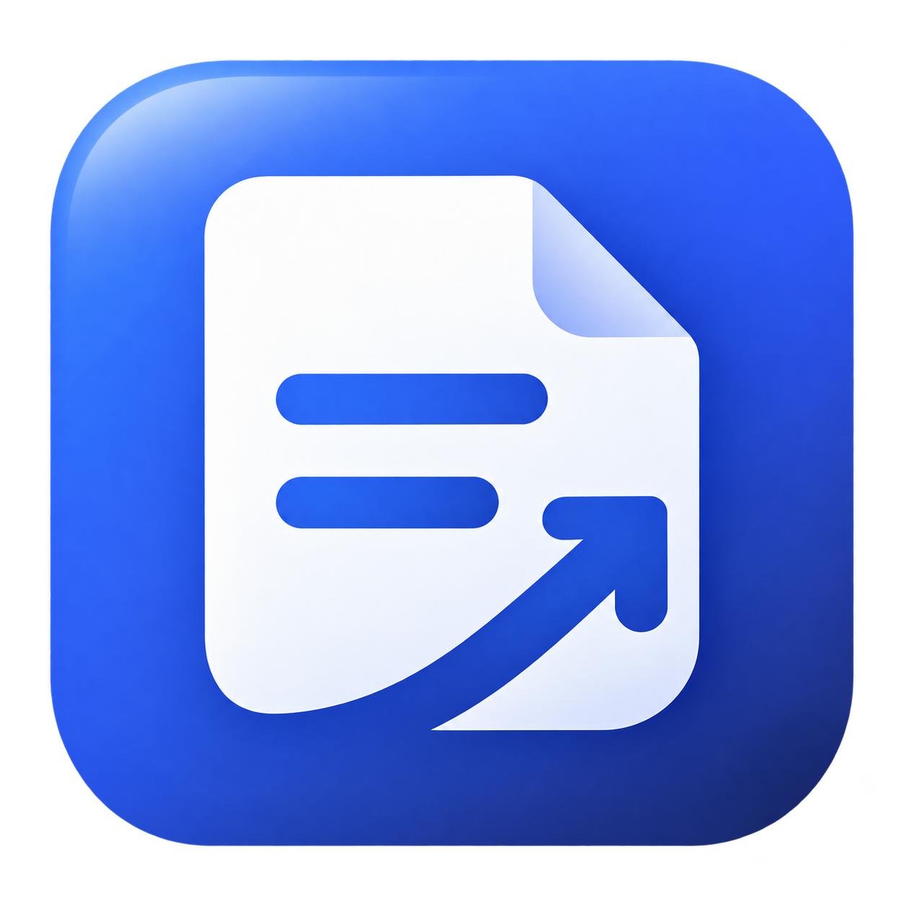

# 拾简 Resume Studio

## 当前 Fork：多级导航、登录会话采集与 WebDAV 同步

维护仓库为 [ljy87263621/resume-studio](https://github.com/ljy87263621/resume-studio)，上游基准为 `scj040921/resume-studio@e71aa3d`。本轮延续 WinUI 3/C#、Java 21 和 Portable 分发，新增功能与验收边界见 [接管说明](docs/TAKEOVER.md)。下面的版本记录保留上游历史。

- 发现职位包含“主页面”和“公司来源管理”，经典/Haru 均支持展开、选择与窄屏导航。
- 主页面可在应用内本人登录 BOSS/牛客，正常浏览、搜索和翻页时自动采集实际返回的职位 JSON、初始数据与可见内容，核对后批量收藏。每次最多收集 500 条、确认保存最多 50 条；访问拒绝或登录失效会暂停并提示处理。真实登录后平台采集仍需本人验收。
- 设置中的手动 WebDAV 同步覆盖简历、内嵌照片、历史、收藏、投递快照/时间线、日程、公司来源及非敏感设置；Cookie、API Key、同步密码留在本机。优先使用强 ETag 条件写入；缺少强 ETag 时用整包内容 SHA-256、上传前复查及上传后回读验证兼容，请同一时间只在一台设备同步。双方修改时明确选择整包方向，导入前保存完整备份，本机导入仍使用 CAS。
- WebDAV 配置：填写服务提供的入口或已有文件夹地址，新配置默认在其下自动创建并使用 `ResumeStudio/`；已保存配置保留原同步目录，已填 `ResumeStudio/` 时不会重复追加。坚果云可直接填 `https://dav.jianguoyun.com/dav/`，用户名填坚果云账号，密码填“安全选项 → 第三方应用管理”生成的应用密码。首次同步通过 `PROPFIND Depth: 0` 检查目录，缺失时发送无正文 `MKCOL` 并回查验证；同名文件、权限不足、不支持建目录或父目录不存在时明确停止。新配置的入口必须已存在，不递归创建 WebDAV 服务入口。
- [同步协议](docs/SYNC-PROTOCOL.md)与[JSON Schema](docs/resume-studio-sync.schema.json)定义 v1 格式，保留实体与封装扩展字段。GitHub 同步后端仅预留接口。WebDAV 包为个人服务器上的明文 JSON。
- 新增统一验证入口 `scripts/test-features.ps1`，原生隔离导航/设置验证使用 `scripts/test-navigation-ui.ps1`。正式发行前配置 Fork 自有签名密钥；启动更新检查默认关闭。

```text
发现职位
  ├─ 主页面
  └─ 公司来源管理
```




Java 后端 + 原生 WinUI 3 Windows 客户端，支持简历制作、PDF 导出、企业官网职位查询、收藏和投递进度管理。GitHub 高星简历模板已移植到桌面编辑与导出流程。来源、固定提交、星数核实时间与许可见 [THIRD_PARTY_NOTICES.md](THIRD_PARTY_NOTICES.md)。

## v0.7.4：一键安装与自动快捷方式

- 新增中文 Setup 安装包，一键安装到当前用户目录，自动创建桌面及开始菜单快捷方式。
- 支持覆盖安装和 Windows 卸载入口，个人简历及求职数据保留；缺少 WebView2 时自动补装。
- Stable／Nightly 同时提供 Setup 与 ZIP，详见 [安装说明](docs/INSTALLATION.md)。

## v0.7.3：修复 Nightly 更新列表 403

- Stable／Nightly 优先读取 GitHub Release 中的签名索引，避开匿名发行 API 配额；包大小与摘要仍严格校验。
- 发布工作流自动刷新索引，保留 API 备用和直连／公益代理线路。首次升级见 [更新说明](docs/UPDATES.md)。

## v0.7.2：修复企业官网职位解析

- 支持从企业官网正文读取岗位职责、任职资格和工作地点，修复没有职位元数据时无法收藏的问题。
- 自动解析与浏览读取均支持 WordPress 和通用正文容器，排除导航／页脚／隐藏内容，保留原链接。

## v0.7.1：编辑与日程交互优化

- 页面入场、卡片悬停和按钮按压动效，可在设置中关闭；慢操作显示进度并防止重复提交。
- 简历编辑增加填写进度、展开分组、字数统计、Ctrl+B 和预览模块定位，自动保存状态清晰可见。
- 日程增加统计、类型筛选、快速添加、展开详情和完成后撤销；撤销保留后续编辑。
- 使用与验证范围见 [v0.7.1 说明](docs/ITERATION-0.7.1.md)。

## v0.7.0：照片双版预览、求职日程与 MiSans

- 模板卡片并排显示有证件照占位／无证件照两种真实预览，分别可放大查看。
- 求职日程提供月历、近期列表、自定义安排和软件内提醒，自动汇总并同步投递记录的安排。
- 界面统一 MiSans，简历默认 MiSans 并提供多种字体选择；随包字体可离线加载和嵌入 PDF。
- 使用与验证范围见 [v0.7.0 说明](docs/ITERATION-0.7.0.md)。

## v0.6.3：修复模板中文乱码

- 模板目录由 Java 直接写入 UTF-8 文件，避免英文构建环境的控制台编码把中文转换成问号。
- 发布前核对全部模板字段，检查非中文控制台环境及损坏数据拒绝；模板名称、说明、分类和栏目标题恢复中文。

## v0.6.2：修复更新器目录占用

- 更新器在独立的更新工作目录启动，并将 PowerShell 工作位置与进程工作目录移出安装目录，避免更新器自身阻止程序目录重命名。
- v0.6.0 / v0.6.1 的旧更新器需要先修补本机更新脚本，或手动下载完整新版；详见 [更新说明](docs/UPDATES.md)。

## v0.6.1：修复 Haru 界面窗口拖动

- Haru / haruphoto 风格的窗口顶部空白处和页面标题卡片均可拖动，区域随窗口大小、导航布局与显示缩放更新，保留菜单和系统窗口按钮的交互。
- v0.6.0 用户可通过“设置 → 软件更新”获取此修复；Stable / Nightly 发布与签名校验机制继续沿用。

## v0.6.0：GitHub Releases 更新与 Stable / Nightly

- 软件更新读取 GitHub Releases，提供 Stable / Nightly 和公益代理备用通道。签名及 SHA-256 验证通过后才能安装，失败恢复旧程序。
- 每次推送自动编译；Nightly 每天北京时间 08:30 有源码变化才发布，Stable 由正式版本标签发布。详细规则见 [更新与发行说明](docs/UPDATES.md)。

## v0.5.0：全新图标、编辑、岗位定制与投递跟进

- 模块格式按钮、撤销重做、最多 20 个压缩历史版本，以及实际 PDF 页数、缩略图和疑似空白页检查。
- 职位要求与简历原文对照；可配置兼容 AI 接口，逐项确认后生成独立岗位简历。密钥按 Windows 当前用户加密保存。
- 投递进度时间线、笔试／面试／跟进安排、应用内提醒、固定投递简历快照与复盘。
- 全新软件图标覆盖程序、窗口、快捷方式与应用内品牌标识。详细范围见 [v0.5.0 迭代记录](docs/ITERATION-0.5.0.md) 与 [图标设计说明](docs/BRAND.md)。

## v0.4.2 安装体积、整体玻璃与职位链接解析

- 按需引用 WinUI 组件，不再随包携带未使用的 AI / ML / Widgets 组件；继续自包含 Java、.NET 和 WinUI，用户无需额外安装这些运行环境。
- 可选 Haru 界面使用整窗 Desktop Acrylic、透明标题栏、半透明侧栏和内容卡片、高光描边；整个窗口透出背景的模糊颜色。简历纸张与 PDF 保持白底。经典界面仍默认，可在设置中切换。
- 职位卡片直接显示原始链接，支持点击与复制。用于去重的地址单独保存，打开页面时保留 `securityId` 等访问参数。
- 粘贴详情链接后尝试解析公开 JSON-LD 和网页元数据，自动填入可获取的职位、公司、地点、薪资和描述。访问验证 / 登录页不会被当成职位；可选择“浏览并读取”，在正常浏览后读取可见内容再核对收藏。
- 修复多行分享文本预填时丢失链接和后续描述的问题；已有收藏可使用“自动补全”。

## v0.4.1 本机存储优化

压缩上一版本地文档备份、限制日志占用、缩小导入照片，并在设置页查看占用和清理预览缓存。详见 [v0.4.1 迭代记录](docs/ITERATION-0.4.1.md)。

## v0.4.0 性能与双界面

- 默认保持经典界面，在“设置 → 界面版本”切换 Haru 界面；沿用 haruphoto 的低饱和度蓝紫色、原生导航、圆角卡片与轻玻璃顶栏，支持浅色、深色和跟随系统。切换即时生效，数据共用，设置持久化在本机。
- 模板元数据由 Java 模板源在构建时生成，首屏直接读取随应用分发的目录，不必等待本地 Java 服务或访问网络。需要写入数据的操作自动等待服务就绪。
- 工作台采用模块目录，点击基本信息、排版或内容模块编辑，右侧持续展示整份简历。预览环境和 WebView2 跨模块、页面往返复用；输入后更新文档内容和样式，保留预览滚动位置。
- 自动保存与预览分开：停止输入约 650 ms 保存；预览可选 350 / 900 / 1500 ms，亦可关闭实时预览后手动刷新。PDF 导出始终使用最新内容。支持 Ctrl+S 保存；命令栏将次要操作放入溢出菜单。
- 职位和收藏使用原生虚拟化列表，减少长列表控件创建；返回职位页保留已查结果和查询条件。查询可取消等待，页面离开后的旧响应不会覆盖新页面。取消不会立即终止服务器已发出的官网请求，后台请求会按既定期限结束。

“设置 → 本次会话”显示窗口创建后的首屏、服务就绪耗时和预览更新次数。`scripts/benchmark.ps1` 可在隔离目录重复测量，结果在 `artifacts/benchmarks/`；该测量不是系统冷启动或完整进程启动耗时。

实测方法、性能比较和界面预览见 [v0.4.0 迭代记录](docs/ITERATION-0.4.0.md)。

## 企业官网招聘

发现职位默认查询全部启用的来源，增加“公司招聘官网”管理页。预设 **21 个来源**，可以添加、编辑、启用或关闭公司，按国内 / 全球筛选，查看每个来源的实际状态。预设数量不等于已成功接入数量：动态官网没有公开结构化职位时会明确显示“需专用适配”或请求错误。

已实现企业公开招聘系统适配器：**Greenhouse、Lever、Ashby、SmartRecruiters、Workday**，另保留腾讯与 Arbeitnow。使用相同系统的其他公司可配置其公开职位板标识 / 链接，无需改代码。Greenhouse / Ashby 在完整返回的数据内按关键词筛选；Lever、SmartRecruiters、Workday 按源分页，每页20条，城市筛选作用于当前页，Lever 的关键词筛选和数量也仅针对当前页。

官网通用接入采用公开 `schema.org/JobPosting` JSON-LD 提取，读取入口页和最多两个同域招聘链接，检查 robots 规则，不将招聘首页或普通链接伪装成职位。未找到结构化岗位、重定向、网络错误、访问限制都会显式返回状态。华为、阿里、字节、美团等预设官网目前主要是这一检测入口，不能据此宣称已完整接入这些公司的实时职位系统。暂未实现 Workday 以外的所有自研招聘系统、SAP SuccessFactors、Oracle Taleo 和登录后职位。

单轮最多汇总50个启用来源，4个并发请求工作线程，本轮30秒期限；单次官网请求18秒和16MB上限；成功数据缓存10分钟。状态列可打开官网浏览。公开列表不提供完整描述时，详情卡片如实提示前往官网查看；薪资不公开时不补造。所有职位可沿用收藏和投递记录流程。

接入示例：

| 系统 | 公开招聘页 / 公司标识 |
| --- | --- |
| Greenhouse | `job-boards.greenhouse.io/stripe`，标识 `stripe` |
| Lever | `jobs.lever.co/palantir`，标识 `palantir` |
| Ashby | `jobs.ashbyhq.com/notion`，标识 `notion` |
| SmartRecruiters | `jobs.smartrecruiters.com/BoschGroup`，标识 `BoschGroup` |
| Workday | `https://nvidia.wd5.myworkdayjobs.com/NVIDIAExternalCareerSite`，无需额外标识 |

用户添加网址后，客户端会识别常见招聘系统域名；请确认它确实由该公司官方招聘页链接使用。官网请求限制为公共 HTTPS，拒绝本机和私有网络地址，不跟随跨域重定向，不读取浏览器账号和 Cookie。公开数据可能变化，以原站为准。

## 运行

推荐从 [GitHub Releases](https://github.com/scj040921/resume-studio/releases) 下载 ResumeStudio-v0.7.4-Setup-x64.exe，点击“一键安装”自动创建桌面快捷方式。也可下载便携版 `ResumeStudio-v0.7.4-windows-x64.zip`，解压后双击目录中的 `ResumeStudio.exe`。必须保留整个目录，含自包含 .NET / Windows App SDK 及精简 Java 21 运行时。客户端自动启动本地 Java 服务并在关闭窗口时结束该服务，无需手动安装 Java 或 .NET。需要 Windows 10 2004 或更新的 x64 系统及 Microsoft Edge WebView2 Runtime。不要在压缩包内直接运行。

发布附带 `SHA256SUMS.txt`。OpenJDK 源码归档属于运行组件的对应源码，普通用户只需下载应用 ZIP。原创应用代码采用 [MIT](LICENSE)，模板及运行组件保留各自许可，见 [THIRD_PARTY_NOTICES.md](THIRD_PARTY_NOTICES.md) 和 [RUNTIME_NOTICES.md](RUNTIME_NOTICES.md)。

## 功能

- 八套 GitHub 模板岗位适配：前端开发、后端开发、嵌入式开发、通用型各两套。来自 Awesome-CV（28694 星）、billryan/resume（11477 星）、Deedy-Resume（5066 星）、Jake’s Resume（2828 星），星数核实于 2026-10-12。默认展示高星模板，可按岗位、来源、星数 / 名称排序并搜索。六套内置旧模板保留以兼容已有简历。
- 原模板 LaTeX 版式已移植到 HTML/CSS，保留居中抬头、分节、紧凑条目、非对称双栏等特征；统一中文 A4 和系统字体。原始模板、许可证随应用保存于 `ThirdParty`，卡片可查看来源说明并打开原仓库。岗位填法由本应用补充，不能把通用原模板称为上游嵌入式专属模板。
- 多份简历：创建、编辑、复制、删除、JSON 导入导出。
- 基本资料、照片、可增删/隐藏/排序模块；主题色、字号、行距；支持 `## 小标题 | 时间`、`- 列表`、`**加粗**`、Markdown 表格。
- 融合 resume-helper 的模块完成状态和规则建议，增加岗位填写重点、A4 容量估算、AI JSON 提示词复制；基础检查在本地运行；岗位对照还可使用用户配置的在线 AI。未填、待优化、已填、已隐藏分别显示，指标建议要求真实可核实。
- 实时预览、650ms 自动保存、A4 无水印 PDF 导出与打印；模块格式按钮、撤销重做和历史版本。尚未实现 Word 导出。
- 在线职位：腾讯招聘国内岗位，关键词搜索与翻页；城市筛选作用于当前页。Arbeitnow 欧洲岗位属于可选源，网站拦截/网络错误明确显示，无虚构替代数据。
- 招聘页面跳转、收藏、投递进度、简历版本和备注。打开页面仅记为“已打开”，投递需在原站完成，进度手动更新。
- BOSS、猎聘、智联、前程无忧、拉勾、牛客、企业官网的职位详情链接可直接粘贴导入，核对并填写公司、地点、薪资、描述与备注后收藏。跟踪参数归一化后，相同链接更新同一收藏。收藏支持编辑、关键词和平台筛选。这是拾简本地收藏，不同步平台账号收藏。
- BOSS直聘、牛客支持应用内本人登录后的本次浏览会话自动采集，并保留粘贴链接和单页浏览读取。腾讯等公开职位源沿用官网查询。

本 Fork 保留本机优先存储，并提供用户手动配置的 WebDAV 整包同步；没有应用自身账号服务器。在线 AI 仅在主动请求时向用户配置的接口发送内容。招聘登录与验证由用户在应用内正常页面完成，会话不参与同步。简历、收藏、投递、来源和日程持久化在 `%LOCALAPPDATA%/ResumeStudio`；上一版本为 `.json.bak.gz`，简历最多保留 20 个压缩历史版本。数据目录内明文资料可在“使用说明”查看，WebDAV 替换前整包备份保存在 `sync-backups`。删除简历同步传播后，投递记录中的独立快照保留。真实平台登录、实际 WebDAV 服务和干净 Windows 分发仍需后续验收。

## 源码结构

```text
client-winui/                       用户端：原生 WinUI 3
  App.xaml                         应用资源与启动
  MainWindow.cs                    模板、编辑、职位、收藏、投递界面
  MainWindow.Templates.cs          GitHub 模板分类、来源与预览
  MainWindow.Assistance.cs         内容建议、A4 容量与 AI 提示词
  MainWindow.ExternalFavorites.cs  跨平台链接导入与收藏编辑
  MainWindow.CompanyJobs.cs        多官网职位查询与公司来源管理
  Models.cs                        简历与职位数据模型
  Services/BackendClient.cs        本地 Java 进程生命周期 / REST 客户端
  Services/ResumeRenderer.cs       共享预览与 PDF 排版，输入转义
backend/                           服务器端：Java 21，无第三方依赖
  src/main/java/com/resumestudio/
    Server.java                    HTTP 路由、会话校验、输入约束
    Store.java                     JSON 原子写入、上一版备份
    Templates.java                 模板元数据
    ResumeAdvisor.java             本地模块状态和内容规则
    JobCapture.java                链接识别、平台识别、URL 去重
    CompanySources.java            21个预设来源和用户配置
    CompanyJobs.java               五类ATS、官网JSON-LD、并发汇总与状态
    Jobs.java                      职位源适配、缓存、明确错误状态
    Json.java                      JSON 编解码
scripts/                           构建、验证、部署工具
release/ResumeStudio/              可直接运行的完整应用
artifacts/                         验证输出，不属于用户简历数据
```

## 开发与构建

需要 Windows、PowerShell 7、.NET 8 SDK、JDK 21。建议使用 Microsoft Build of OpenJDK 或 Eclipse Temurin 并设置 `JAVA_HOME`。PowerShell 执行 `./scripts/build.ps1`；使用 `dotnet build -c Release -p:Platform=x64` 构建自包含 WinUI 输出，`javac --release 21` 构建后端，`jlink` 生成随应用分发的 Java 运行时。优先读取 `JAVA_HOME`，本机默认 JDK 位于 `C:/Program Files/Java/jdk-21`。应用依赖 `Microsoft.WindowsAppSDK 1.8.260317003` 和 `Microsoft.Windows.SDK.BuildTools 10.0.26100.7705`。

可用 `./scripts/build.ps1 -ReleaseDirectory <新的输出目录>` 为指定 JDK 构建全新运行环境，避免沿用旧目录中的 Java 运行时。`./scripts/package.ps1` 打包完整应用并生成 SHA-256。GitHub Actions 自动构建客户端、后端和精简运行时，运行不依赖实时招聘接口的解析测试。

## 后端接口

仅监听 `127.0.0.1`，所有请求需 `X-Resume-Token` 会话头。客户端为每次启动分配空闲端口与随机会话令牌。

| 接口 | 用途 |
| --- | --- |
| `GET /api/health` | 状态与 Java 版本 |
| `GET /api/templates` | GitHub 与内置模板元数据、来源和分类 |
| `GET /api/job-sources` | 企业官网来源与实际查询状态 |
| `POST /api/sources` / `DELETE /api/sources/{id}` | 保存 / 删除用户公司来源配置 |
| `POST /api/resume-check` | 本地模块完成状态与规则建议，输入完整简历 |
| `POST /api/capture-preview` | 用户复制职位链接 / 文本解析，输入 `{ "text": "..." }` |
| `GET /api/resumes` | 简历列表 |
| `POST /api/resumes` | 创建 / 更新完整简历 |
| `DELETE /api/resumes/{id}` | 删除简历与对应备份 |
| `GET /api/jobs?provider=tencent&keyword=Java&city=&page=1` | 在线岗位查询 |
| `GET /api/jobs?provider=all&keyword=&page=1` | 多企业官网汇总，响应含逐来源状态 |
| `GET /api/favorites` / `POST /api/favorites` / `DELETE /api/favorites/{id}` | 收藏 |
| `GET /api/applications` / `POST /api/applications` / `DELETE /api/applications/{id}` | 投递记录 |

手动运行后端：`java --add-modules jdk.httpserver -jar backend/build/resume-backend.jar --port 19427 --data ./data --token <至少16字符的随机令牌>`。

请求体限制 2 MB，模块上限 30，照片建议小于 600 KB。职位 URL 仅允许 HTTPS。招聘源只请求固定 HTTPS 域名，缓存 10 分钟，获取时间和错误状态随结果返回。腾讯接口由公开官网提供，可能变化；薪资未公开时如实显示。Arbeitnow 源主要面向欧洲，不代表国内招聘覆盖。外部招聘信息以原站为准。

## 验证

`scripts/test-backend.ps1` 验证 API 鉴权、简历增改查删、重启持久化、路径约束、非法输入、实时职位、缓存、收藏与投递。

客户端 `--self-test` 在隔离数据目录内执行原生 WinUI 启动、Java 服务启动、原生文本框编辑与自动保存、全部十四套模板 PDF、多页 PDF、内容转义、真实职位、收藏、投递状态，以及建议规则、跨平台链接去重和 Markdown 表格测试。使用 `RESUMESTUDIO_TEST_DATA` / `RESUMESTUDIO_TEST_OUTPUT` 指定测试目录。测试不会实际访问虚构的 BOSS 测试链接、打开外部浏览器或投递。文件选择器、剪贴板导入弹窗和原站登录投递仍需要人工验收；应用不会代替用户提交。
