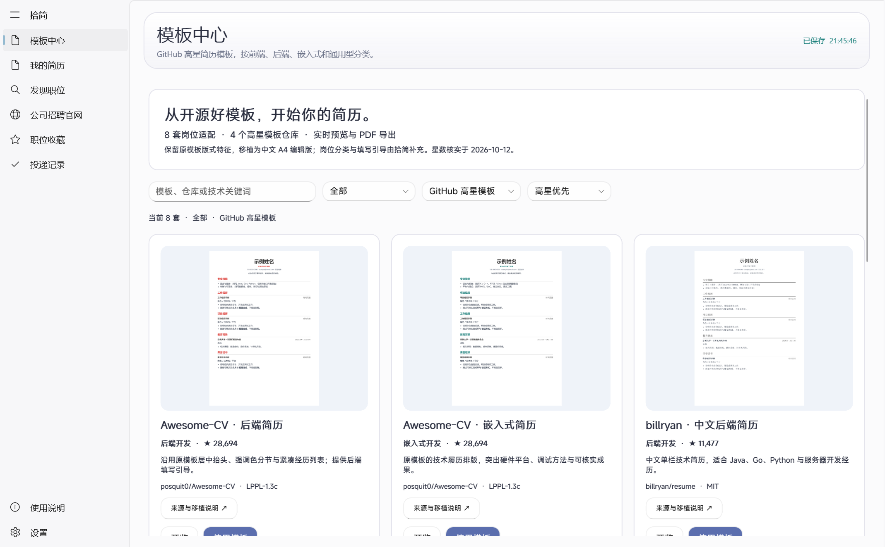

# v0.4.0：首屏、编辑预览与双界面

本轮按用户确认的方向推进：优先改善启动和首次显示、简历编辑；保留经典界面默认，Haru 作为设置中的可选界面；工作台采用模块目录导航与持续预览。

## 界面与交互

Haru 界面的设计语言来自同一作者的 haruphoto：柔和蓝紫色 `#5B6EAE`、圆角卡片、原生 NavigationView、轻玻璃顶栏与清晰的主次操作。支持浅色、深色及跟随系统；只切换界面，不改变 PDF 的纸张和配色。没有复制完整相册界面，也没有在每张卡片增加实时模糊效果。

两套界面共用简历、收藏和投递数据，切换即时生效并持久化。工作台只创建当前模块的编辑字段，基本信息与排版也是独立目录项。Ctrl+S 保存，命令栏容纳导出、打印、备份和建议操作。

## 性能变化

模板目录在 Java 构建时从 `Templates.all()` 生成，客户端首屏直接读取随包 JSON，Java 后端在后台启动。需要数据的操作自动等待同一启动任务。网络客户端改为首次查询时初始化。

WebView2 环境和编辑器实例复用。初次加载文档，随后通过 DOMParser 更新样式与文章内容，保留滚动位置；用户文本仍由原渲染器转义。自动保存不再等待预览刷新；输入停止后约 650 ms 保存，预览单独使用可调节的防抖间隔。关闭实时预览后，手动刷新和 PDF 导出仍同步最新内容。

职位、收藏采用 ListView 的虚拟化容器，避免一次创建所有职位卡片。查询支持取消等待；离开页面或发起新查询后，旧结果不会写入新页面。客户端取消不等于停止已经发出的官网请求。

修复多行输入框初始化顺序，并忽略字段初始加载时的相同值事件，避免重新载入时截断后续行和触发无意义保存。WebView 的逻辑父容器显式解除后再复用，解决切换界面过程中 Parent 为空但旧容器仍拥有控件的情况。

## 同机测量

2026-10-12，Windows x64，.NET 8 SDK 8.0.423，同一 Java 21.0.12.1、同一模板资源。基线为 v0.3.0 加计时钩子；两版本依次各测三次，每次独立测试数据及 WebView2 目录，未与功能测试同时运行。连续启动时 OS 文件缓存可能已预热。

| 指标（3 次中位数） | v0.3.0 基线 | v0.4.0 |
| --- | ---: | ---: |
| 首屏可用，窗口内部计时 | 843.7 ms | 240.5 ms |
| 再次打开编辑器并等待预览 | 192.9 ms | 55.6 ms |
| 首次打开编辑器并等待预览 | 491.8 ms | 493.3 ms |
| Java 后端就绪，窗口内部计时 | 788.2 ms | 843.0 ms |
| 客户端进程私有内存 | 133.8 MB | 124.1 MB |
| 同一测量流程预览实例初始化 | 2 | 1 |
| 同一测量流程整页加载 | 5 | 1 |

首屏约减少 71.5%，再次进入编辑器约减少 71.2%。首次 WebView2 初始化和 Java 后端就绪没有显著改善；30 次短文本输入的总测量时间差异很小，不据此宣称打字延迟有显著提升。内存数据只统计客户端进程，不包含 Java 与 WebView2 子进程。该结果不代表完整进程启动或系统冷启动时间。

首屏三次样本：基线 `934.7 / 843.7 / 836.1 ms`；新版本 `240.4 / 251.1 / 240.5 ms`。重复编辑器样本：基线 `192.9 / 215.3 / 174.7 ms`；新版本 `55.6 / 51.5 / 63.1 ms`。

复测命令：`./scripts/benchmark.ps1 -ApplicationDirectory ./release/ResumeStudio -Samples 3 -Label current`。结果写入忽略提交的 `artifacts/benchmarks/`，测试模式默认使用隔离目录。

## 验证范围

- Java 严格编译，原生 WinUI 构建通过；本机构建 0 警告、0 错误。
- 后端 34 项检查通过，包括鉴权、保存、重启持久化、官网查询、来源状态、收藏和投递。
- 原桌面 19 项链路验证通过：原生文本编辑、自动保存、14 套模板 PDF、多页 PDF、内容转义、实际招聘信息和投递记录。
- 新增 6 项验证通过：1000 条职位的虚拟化与滚动、模块内容与最新预览、原生界面选择器与设置持久化、Haru 深浅主题与预览复用、手动预览下保存和最新 PDF、恢复经典界面。
- 检查了实际 WinUI 界面截图、浏览器预览与 PDF 渲染。WinUI RenderTargetBitmap 截图无法包含 WebView2 的独立呈现区域，浏览器预览另行捕获核对。

未覆盖所有 Windows 设备、系统冷启动、原站登录投递和人工文件选择器操作。官网覆盖范围沿用上一版本，不将入口数量当作成功采集数量。
